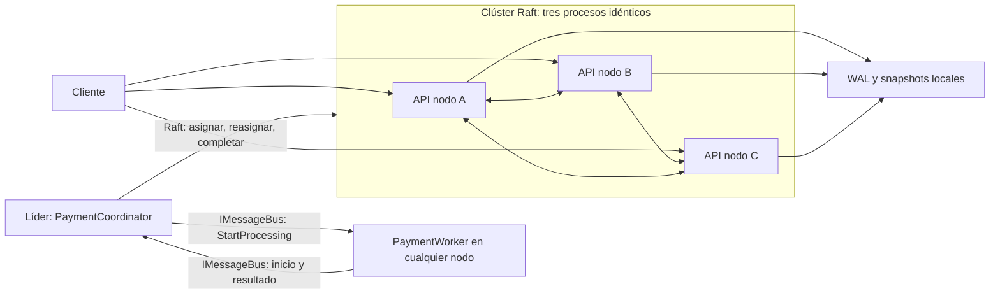

# SolidarityGrid

SolidarityGrid es una prueba de resiliencia para pagos **simulados**. El cliente envía una solicitud a cualquiera de tres nodos; el clúster confirma su aceptación, asigna un Worker y recupera el trabajo si el responsable desaparece. La garantía central es una sola finalización lógica confirmada, aunque el procesamiento físico pueda repetirse.

## Arquitectura



Los tres nodos ejecutan .NET 10 y C# 14. DotNext.AspNetCore.Cluster 6.12.0 aporta Raft, elección de líder, barreras de lectura e `IMessageBus`. Una biblioteca probada evita reimplementar el consenso. Docker Compose permite reproducir el clúster localmente, con un volumen persistente por nodo.

El líder coordina las decisiones; `PaymentStateMachine` aplica comandos confirmados y persiste estado en WAL y snapshots. `PaymentCoordinator` supervisa el trabajo pendiente y propone una reasignación tras perder al Worker o vencer un plazo. Cada `PaymentWorker` ejecuta hasta dos trabajos en paralelo. Los mensajes viajan por `IMessageBus`; el estado Raft es la fuente de verdad. Cada reasignación incrementa `Attempt` y la máquina de estados rechaza resultados de generaciones anteriores. Un líder nuevo reconstruye el seguimiento desde el estado replicado.

## Ejecución

Requiere SDK .NET 10, Python 3, Docker Engine/Desktop con contenedores Linux y Docker Compose.

```powershell
docker compose up --build -d
docker compose ps
curl.exe http://127.0.0.1:5001/cluster
curl.exe http://127.0.0.1:5002/health/ready
curl.exe -X POST http://127.0.0.1:5002/pay -H "Content-Type: application/json" -H "Idempotency-Key: demo-001" -d '{"durationSeconds":10}'
curl.exe http://127.0.0.1:5003/payments/ID_DEVUELTO
docker compose logs --no-color --tail 100
docker compose stop
```

Las API usan `localhost:5001`, `5002` y `5003`; Raft y `IMessageBus` usan el puerto interno 8081. `POST /pay` exige `Idempotency-Key` y una duración de 5 a 10 segundos; devuelve `202` tras confirmar aceptación. La misma clave y contenido devuelve el mismo ID; contenido distinto devuelve `409`. `GET /payments/{id}` usa lectura fuerte y muestra `Accepted`, `Processing` o `Completed`. Sin quórum puede devolver `503`. Ante una aceptación incierta por timeout, repita la clave y el contenido originales.

El formato `solidarity-grid-payments-v3` usa volúmenes v3 nuevos. Los v1/v2 se conservan; no se migran ni eliminan automáticamente. `docker compose stop` retiene datos. Evite `down -v` si necesita los volúmenes.

## Demostración y verificación

```powershell
py scripts/demo-step05.py
dotnet restore SolidarityGrid.slnx --locked-mode --configfile NuGet.Config
dotnet build SolidarityGrid.slnx -c Release --no-restore
dotnet test SolidarityGrid.slnx -c Release --no-build
py scripts/verify-resilience.py
py scripts/verify-step05.py
```

La demostración identifica dinámicamente al Worker, espera su inicio, lo detiene con `docker compose kill`, espera la reasignación y la finalización, y reinicia el contenedor sin borrar datos. `verify-resilience.py` cubre líder, P2P, Worker obsoleto, quórum, reinicio y compatibilidad. `verify-step05.py` repite tres recuperaciones, satura Workers y prueba partición de red con el proceso aislado vivo. Evidencias: `.artifacts/step04/`, `.artifacts/step05/` y [validación final](docs/STEP_05_VALIDATION.md).

Configuración: `Grid__MaxConcurrentPayments=2`, `Grid__WorkerStartTimeoutSeconds=5`, `Grid__ProcessingTimeoutSeconds=20`, `Grid__LeadershipGracePeriodSeconds=5` y `Grid__UnavailableGracePeriodSeconds=2`.

## Garantías y límites

Raft ordena las decisiones y las generaciones impiden que un Worker obsoleto complete una transacción. Una prueba unitaria cuenta una transición efectiva aun con ocho propuestas concurrentes. La ejecución física puede repetirse. La PoC no procesa dinero real ni mantiene cuentas o saldos. Sin mayoría disponible se preserva consistencia y no se aceptan decisiones nuevas. `IMessageBus` no es una cola durable: el Coordinator redescubre trabajo en Raft. Docker Compose utiliza un solo anfitrión y no demuestra tolerancia a la pérdida de este.
