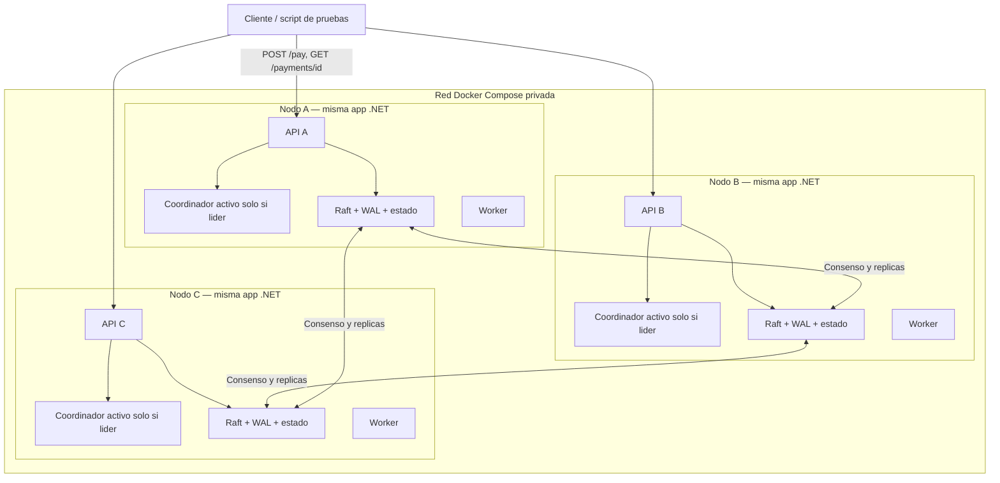

# SolidarityGrid — Arquitectura de la PoC

**Estado:** diseño aprobado para implementación incremental.  
**Objetivo:** demostrar recuperación automática e idempotencia lógica con tres nodos .NET idénticos, sin broker externo ni base de datos centralizada.  
**Fuente del reto:** *Especialista técnico de Plataforma 2025*, «El Protocolo del buen Samaritano (Payment Mesh Resilience)».

## 1. Decisiones

- **Runtime:** C# 14 / .NET 10 LTS, ASP.NET Core 10 Minimal API.
- **Imágenes de contenedor:** build `mcr.microsoft.com/dotnet/sdk:10.0`; ejecución `mcr.microsoft.com/dotnet/aspnet:10.0`. El proyecto debe usar `TargetFramework` `net10.0`; fijar la versión de DotNext para reproducibilidad.
- **Topología:** exactamente tres instancias del mismo binario (`node-a`, `node-b`, `node-c`) sobre la red privada de Docker Compose.
- **Consenso:** Raft implementado por **DotNext.AspNetCore.Cluster 6.12.0** (objetivo `net10.0`); contrastar las APIs con los ejemplos y documentación vigentes de esta versión.
- **Comunicación entre nodos:** `DotNext.Net.Cluster.Messaging.IMessageBus` sobre el transporte HTTP integrado de DotNext, con handlers de mensajes propios. No introducir gRPC ni un `HttpClient` P2P adicional si `IMessageBus` satisface los casos.
- **Persistencia:** configurar explícitamente el WAL persistente de DotNext más almacenamiento persistente de la configuración del clúster; volumen independiente por nodo. **No** utilizar `ConsensusOnlyState` por defecto para el estado de pagos.
- **Estado de aplicación:** máquina de estados determinista aplicada únicamente a comandos **confirmados** por Raft y con recuperación correcta tras reinicios; considerar `SimpleStateMachine` si su API existe en 6.12.0 y cumple el caso.
- **Sin servicios centrales:** ni broker, ni Redis, ni PostgreSQL compartido, ni balanceador obligatorio. Cualquiera de los tres puertos publicados recibe tráfico de prueba.
- **Membresía:** tres miembros configurados de antemano; no eliminar un nodo de la configuración Raft solo por quedar temporalmente inalcanzable.
- **Quórum:** mayoría de 2 de 3 para confirmar cambios; con un único nodo alcanzable, rechazar temporalmente nuevas confirmaciones.
- **Alcance financiero:** pago simulado con espera de 5–10 segundos; sin cuentas, saldos, ledger ni movimiento real de dinero.

## 2. Arquitectura lógica

**Nota:** `IMessageBus` es P2P y no es una cola persistente. Las asignaciones, finalizaciones y la idempotencia viven en el estado replicado, no en mensajes efímeros.

## 3. Componentes dentro de cada nodo

| Módulo / carpeta | Responsabilidad |
| --- | --- |
| `Api` | `POST /pay`, `GET /payments/{id}`, `GET /cluster`, health/readiness. |
| `Core/Transactions` | Modelo, estados, comandos, validaciones e idempotencia. Sin dependencia de DotNext. |
| `Infrastructure/Raft` | DotNext, WAL, configuración de miembros, aplicación/replay de comandos, lectura consistente. |
| `Infrastructure/Messaging` | `IMessageBus`, mensajes tipados y handlers, retransmisión y manejo de errores. |
| `Processing` | `PaymentWorker` y `PaymentCoordinator` como hosted services. |
| `Observability` | Logging estructurado; correlación por `TransactionId`, `Attempt`, `NodeId`, término y líder. |

**Un solo servicio desplegable** (no crear microservicios por componente). Un proyecto principal y uno de pruebas son suficientes al principio.

## 4. Contratos funcionales

### HTTP externo

- `POST /pay`: encabezado obligatorio `Idempotency-Key`, carga opcional `{ "durationSeconds": 10 }` (validar entre 5 y 10), responder `202 Accepted` + `transactionId` solo después de confirmar y aplicar `AcceptPayment`.
- `GET /payments/{transactionId}`: estado consistente `Accepted | Processing | Completed`, trabajador vigente y generación; nunca una lectura obsoleta presentada como definitiva.
- `GET /cluster`: `nodeId`, rol Raft, `leaderId` si se conoce, indicador de quórum/readiness; ruta diagnóstica.
- `GET /health/live` y `GET /health/ready`: separar proceso vivo de clúster disponible, para que reinicios y elecciones sean observables.

La clave de idempotencia se asocia con una huella canonizada del contenido. Misma clave y mismo contenido => misma operación; misma clave y contenido distinto => conflicto 409. No usar reloj o valores aleatorios dentro de la aplicación determinista del log.

### Mensajes DotNext `IMessageBus` (contratos lógicos, nombres orientativos)

- `SubmitPayment`: nodo receptor -> líder; petición/respuesta con idempotencia.
- `StartAttempt`: coordinador -> worker asignado; incluye `TransactionId`, `Attempt` y duración.
- `CompleteAttempt`: worker -> líder; incluye `TransactionId`, `Attempt` y resultado del delay.
- `WorkAck` / `CompletionAck`: confirmación de recepción de mensaje, **no** confirmación Raft. Los mensajes se pueden reenviar.

Se prefiere request/reply donde simplifique errores; los reintentos deben ser seguros. Verificar el contrato real de mensajes en DotNext 6.12.0 antes de implementarlo.

### Comandos persistentes de Raft

- `AcceptPayment(transactionId, idempotencyKey, requestFingerprint, durationSeconds, createdAt)`
- `AssignPayment(transactionId, workerId, newAttempt, expectedStatus)`
- `ReassignPayment(transactionId, previousAttempt, workerId, newAttempt)`
- `CompletePayment(transactionId, attempt, completedAt)`

**Cada comando se valida en la máquina de estados al aplicarse**, no solo al recibirse en el líder. Su aplicación debe ser determinista, atómica desde la perspectiva de consultas y segura ante replay. Si Raft replica dos comandos en competencia, el segundo debe volverse no-op o rechazo coherente con el primero.

## 5. Protocolo de extremo a extremo

1. Cualquier nodo recibe `POST /pay` y manda la intención al líder mediante `IMessageBus` si no es líder.
2. El líder propone `AcceptPayment` a Raft; espera que quede **aplicado** antes de devolver `202`.
3. El coordinador del líder elige un worker (round-robin simple) y propone `AssignPayment` con `Attempt=1`.
4. Solo cuando la asignación esté confirmada/aplicada, el líder manda `StartAttempt` al worker por `IMessageBus`. Reenvíos usan el mismo `Attempt`; el worker no debe duplicar tareas concurrentes para ese intento.
5. El worker simula 5–10 segundos **fuera** del log Raft, y remite `CompleteAttempt` al líder conocido; ante fallos de comunicación, encuentra al nuevo líder y reintenta.
6. El líder propone `CompletePayment`. Al aplicarse, el estado verifica que el pago no esté completado y que `Attempt` coincida con el vigente. Solo se registra una finalización lógica.
7. El cliente consulta el resultado desde cualquier nodo usando lectura linealizable (p. ej. read barrier) o enrutamiento al líder con garantías equivalentes.

## 6. Recuperación

- El coordinador solo está activo cuando el nodo tiene liderazgo. La pérdida de liderazgo detiene su capacidad de proponer asignaciones.
- El líder mantiene temporizadores **locales** de progreso; parámetro inicial sugerido: 20 segundos sin finalización para un procesamiento de hasta 10 segundos.
- Si un intento se considera abandonado, el líder propone `ReassignPayment` con `previousAttempt` y genera un número mayor. La reasignación debe ser confirmada/aplicada antes del nuevo despacho.
- Al cambiar el líder, el nuevo coordinador reconstruye los trabajos pendientes desde el estado replicado, adopta un período de gracia y reenvía/reasigna según corresponda.
- Si el antiguo worker termina después del cambio, `CompletePayment` con intento obsoleto no afecta el estado.
- Si un `Completed` fue aplicado pero se perdió la respuesta, el reintento retorna el resultado existente.
- No se garantiza ejecución física única del delay; **sí una sola finalización lógica confirmada**.

## 7. Restricciones y escenarios de prueba

**Invariantes**
1. Cada clave idempotente aceptada mapea a un solo `TransactionId`.
2. Un `TransactionId` alcanza `Completed` como máximo una vez en el estado replicado.
3. Solo un `Attempt` está vigente por transacción.
4. Una generación antigua nunca puede finalizar después de una reasignación aplicada.
5. Un nodo sin quórum no confirma nuevas transiciones.
6. Reinicios y replays recuperan el mismo resultado lógico.

**Pruebas**
- Clúster de tres nodos -> un líder; matar líder -> otro elegido con mayoría.
- Matar worker no-líder en segundo 3 -> reasignación y Completed.
- Matar líder/worker en segundo 3 -> elección + recuperación + Completed.
- Duplicar POST y duplicar Complete -> una finalización.
- Mensajes StartAttempt perdidos -> reenvío con mismo attempt.
- Antiguo worker termina tarde -> resultado descartado.
- Aislar un nodo -> solo el lado con 2 miembros confirma.
- Conservar volúmenes, reiniciar -> estado recuperado.

Usar `docker compose kill node-a` (no `stop`) para simular caída abrupta; desactivar reinicio automático durante la demostración. Arranque completo: `docker compose up --build -d`.

## 8. Plan por incrementos

1. **Fundación:** tres nodos DotNext, WAL y membresía persistente, observabilidad de líder/quórum, `IMessageBus` ping entre nodos, Compose de un comando.
2. **Estado:** comandos `AcceptPayment`, recuperación por replay/snapshot, idempotencia concurrente y lecturas consistentes.
3. **Camino feliz:** `POST /pay`, asignación, `StartAttempt`, delay y `CompletePayment`.
4. **Autocuración:** supervisor, timeout, generación/fencing, recuperación tras caída de worker o líder.
5. **Caos y documentación:** escenarios automatizados, scripts, README y diagramas; evidencia de unicidad de finalización.

**Gate obligatorio:** no empezar el incremento 2 hasta verificar con procesos/contenedores reales el quórum, la elección y los mensajes punto a punto de DotNext 6.12.0 sobre .NET 10.

## 9. Riesgos declarados

- La documentación principal de DotNext puede evolucionar: contrastar firmas y ejemplos con la **versión 6.12.0** antes de escribir APIs concretas.
- El WAL y el almacenamiento de configuración deben persistir realmente en los volúmenes. El grado de durabilidad frente a apagado físico súbito depende de la política de flush del WAL; la PoC evalúa principalmente fallos abruptos de procesos/contenedores.
- Una sola máquina anfitriona sigue siendo un punto único de fallo físico; la resiliencia demostrada es a nivel de nodos.
- `IMessageBus` no garantiza procesamiento exactly-once; la máquina de estados sí impone una finalización lógica única.

## Referencias oficiales

- https://dotnet.github.io/dotNext/features/cluster/raft.html
- https://dotnet.github.io/dotNext/features/cluster/index.html
- https://dotnet.github.io/dotNext/features/cluster/wal.html
- https://www.nuget.org/packages/DotNext.AspNetCore.Cluster/6.12.0
- https://dotnet.microsoft.com/en-us/platform/support/policy
